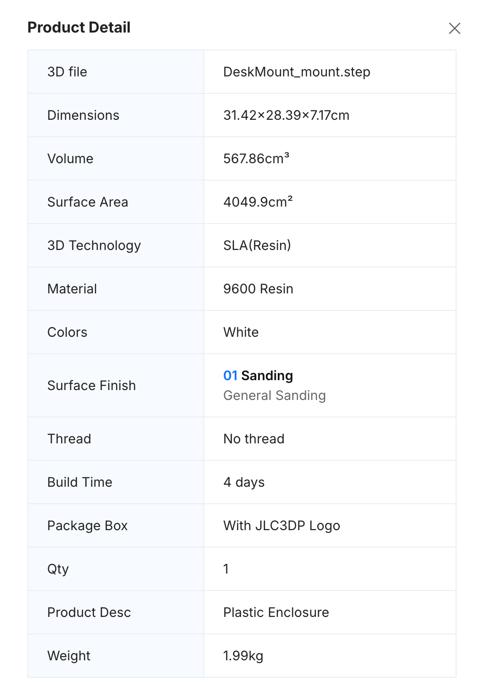
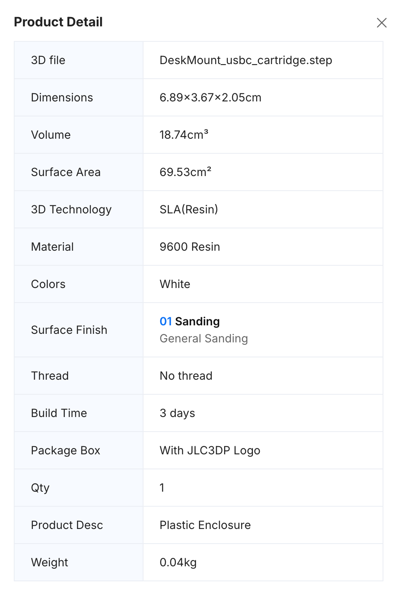

# Fabrication

JLC3DP order details, 2026-10-28. Both parts print separately.

| Part | 3D file | Process | Material | Colour | Finish | Dimensions | Volume | Weight | Build time | Qty |
|---|---|---|---|---|---|---|---|---|---|---|
| Mount | `DeskMount_mount.step` | SLA (resin) | 9600 Resin | White | General sanding | 314.2 × 283.9 × 71.7 mm | 567.86 cm³ | 1.99 kg | 4 days | 1 |
| Cartridge | `DeskMount_usbc_cartridge.step` | SLA (resin) | 9600 Resin | White | General sanding | 68.9 × 36.7 × 20.5 mm | 18.74 cm³ | 0.04 kg | 3 days | 1 |

The cartridge is in 9600, a standard resin. DFM check 20 (`dfm/DFM_JLC3DP_SLA.md`) recommends a tough resin or FDM PETG for its flex arms. Inspect the arm roots for cracks after the first insertions.

## Order screenshots

